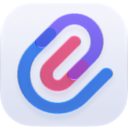
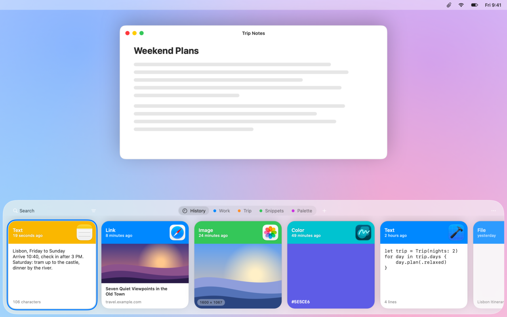
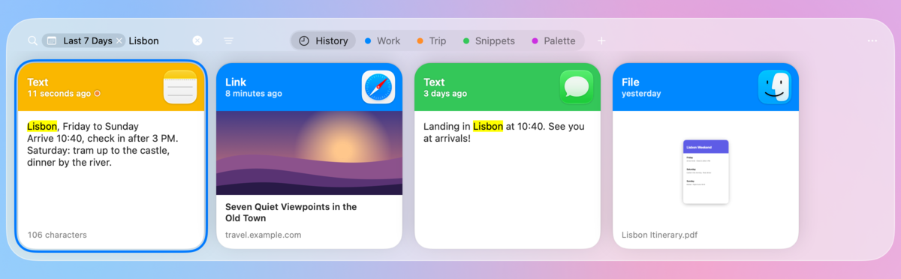
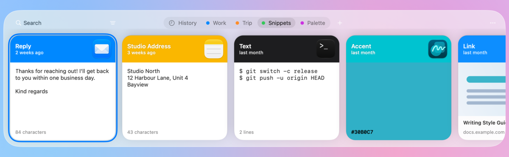
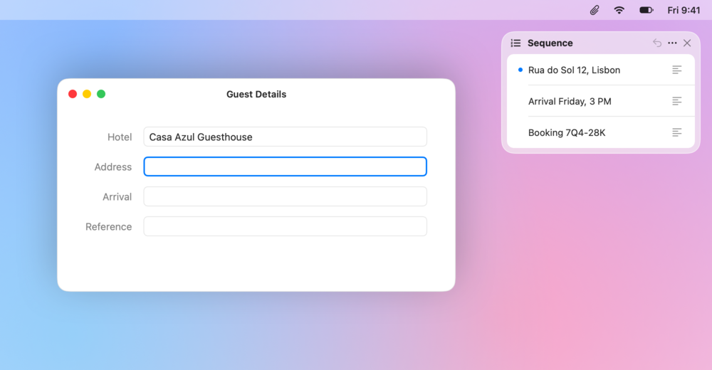
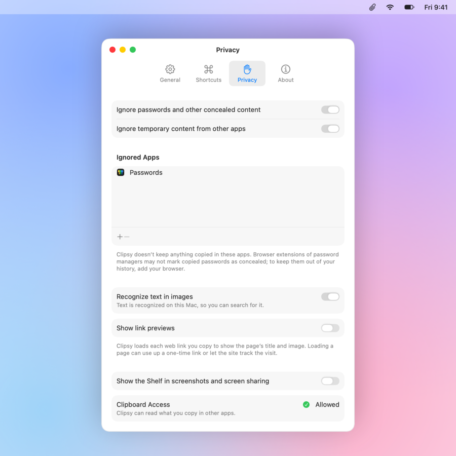

<div align="center">

<picture>
  <source media="(prefers-color-scheme: dark)" srcset="docs/images/icon-dark.png">
  
</picture>

# Clipsy

**A clipboard manager for macOS that feels like part of the system.**

<a href="https://github.com/alekseylopukh/clipsy/releases/latest"></a>

Free · Open source · macOS 26+

</div>

<picture>
  <source media="(prefers-color-scheme: dark)" srcset="docs/images/shelf-dark.png">
  
</picture>

What you copy lands on the Shelf at the bottom of the screen: text, links, images, files and colors. Press ⇧⌘V, find what you need and paste it back with Return.

## Why Clipsy

- **It looks like macOS.** System controls, SF Symbols, Liquid Glass, light and dark mode. No custom theme to get used to.
- **It's free.** GPL-3.0, with no account, trial, subscription or upsell.
- **Your history stays on your Mac.** No telemetry and no sync. See [Privacy](#privacy).
- **It works from the keyboard.** Open, search, pick and paste without touching the mouse.

## A quick tour

### Search with filters

Type to search everything you've copied, including text inside images. Narrow it down with filters for type, app, date and board.

<picture>
  <source media="(prefers-color-scheme: dark)" srcset="docs/images/search-dark.png">
  
</picture>

### Boards

Keep snippets you reuse on colored boards. Cards on a board never expire.

<picture>
  <source media="(prefers-color-scheme: dark)" srcset="docs/images/board-dark.png">
  
</picture>

### Sequence

Collect several items, then paste them one after another with ⌘V, for example to fill in a form.

<picture>
  <source media="(prefers-color-scheme: dark)" srcset="docs/images/sequence-dark.png">
  
</picture>

### Privacy settings

Passwords, temporary content and apps you choose are never recorded.

<p align="center">
<picture>
  <source media="(prefers-color-scheme: dark)" srcset="docs/images/privacy-dark.png">
  
</picture>
</p>

## Features

| | |
|---|---|
| **History** | Every copy is kept with all its formats, so rich text and images paste back intact. Keep it from a day to forever. [More](docs/product.md#31-capture-and-history) |
| **Shelf and cards** | Previews for each type, Quick Look, editing of text, links and colors, custom titles, drag and drop. [More](docs/product.md#32-shelf-and-cards) |
| **Pasting** | Paste into the app you were using, as plain text, or with ⌘1…⌘9. [More](docs/product.md#33-pasting) |
| **Sequence** | Paste a queue of items in order. [More](docs/product.md#34-sequence) |
| **Boards** | Named, colored collections that stay until you remove them. [More](docs/product.md#35-boards) |
| **Search** | Instant search with filters and text recognized in images. [More](docs/product.md#36-search) |
| **Automation** | Shortcuts actions and a `clipsy://` URL scheme. [More](docs/product.md#37-integrations) |

Every shortcut is in the [keyboard map](docs/product.md#5-keyboard-map).

## Privacy

- No account, no telemetry, no analytics, no sync. Your history is stored only on your Mac.
- Clipsy makes two kinds of network request: link previews and update checks. Both are off until you turn them on.
- Passwords and other concealed content, temporary content and ignored apps are skipped. So is text that looks like a token or key.
- Capture can be paused from the menu bar, and the Shelf is hidden from screenshots and screen sharing by default.

All privacy settings are listed in [docs/product.md](docs/product.md#privacy).

## Install

1. Download `Clipsy-<version>.dmg` from the [latest release](https://github.com/alekseylopukh/clipsy/releases/latest).
2. Open the disk image and drag Clipsy to Applications.
3. Open Clipsy. It lives in the menu bar and has no Dock icon.

Releases are signed with a Developer ID and notarized by Apple, so macOS shows only its usual "downloaded from the Internet" confirmation.

### Using Clipsy

Press ⇧⌘V to show or hide the Shelf. This takes over "Paste and Match Style" in apps that use that shortcut; change it in Settings › Shortcuts. ⇧⌘C starts a Sequence and ⌃⌥⌘V pastes every card in it.

### Permissions

- **Accessibility** lets Clipsy paste straight into the app you were using. A Sequence started from another app also needs it to copy your selection. Without it, Clipsy puts the item on the clipboard and you press ⌘V yourself. Grant it in System Settings › Privacy & Security › Accessibility. If you skip it, Clipsy asks again on the first paste; choose "Don't ask again" to stay in copy-only mode.
- **Paste from Other Apps:** macOS may ask before Clipsy reads what you copy, or block it. Set Clipsy to Allow in System Settings › Privacy & Security › Paste from Other Apps, or your history will miss items.

On first launch a short setup window sets the Shelf shortcut, asks for these permissions and offers Open at login, history length and link previews. Every step can be skipped.

If pasting stops working after an update or a reinstall, remove Clipsy from the Accessibility list and add it again. macOS ties the permission to the app's signature.

### Updates

Clipsy never checks for updates on its own unless you turn on automatic checks in Settings › About. "Check for Updates…" there or in the menu bar menu checks once. Updates are signed and verified before they install.

### Uninstall

1. If Clipsy opens at login, turn that off in Settings › General.
2. Quit Clipsy from its menu bar menu, then move it from Applications to the Trash.
3. To remove your data too, delete `~/Library/Application Support/Clipsy/` (history, boards, images and backups) and run `defaults delete app.gonar.clipsy` (settings and shortcuts).
4. To clear its permissions, run `tccutil reset Accessibility app.gonar.clipsy` and remove Clipsy from Paste from Other Apps in System Settings.

## Building from source

Requires macOS 26 and Xcode 27.2 or later. Swift packages (GRDB, KeyboardShortcuts, Sparkle) are fetched on the first build.

```bash
git clone https://github.com/alekseylopukh/clipsy.git
cd clipsy
scripts/build.sh        # build the app (Debug) into .build/DerivedData, signed with your Apple Development identity if you have one
scripts/build.sh test   # run the tests
open .build/DerivedData/Build/Products/Debug/Clipsy.app
```

A Debug build needs no Apple developer account. Without an Apple Development identity it stays signed ad hoc, and macOS asks for Accessibility again after each rebuild. Set `CLIPSY_SIGN_IDENTITY=-` to force an ad-hoc signature.

Release builds are made by `scripts/release/release.sh`, which needs the maintainer's signing and notarization secrets. `scripts/release/release.sh --dry-run <version> <build-number>` runs the whole pipeline without them. See [architecture §6.4](docs/architecture.md#64-release-pipeline).

The screenshots above are rendered from made-up data; [docs/images](docs/images/README.md) explains how to regenerate them. To contribute, start with [CONTRIBUTING.md](CONTRIBUTING.md).

## License

[GPL-3.0](LICENSE). Third-party code and its licenses are listed in [THIRD_PARTY_NOTICES.md](THIRD_PARTY_NOTICES.md). To report a security issue, see [SECURITY.md](SECURITY.md).

Clipsy is an independent project. It is not affiliated with or endorsed by Paste Team ApS, the makers of Paste.
