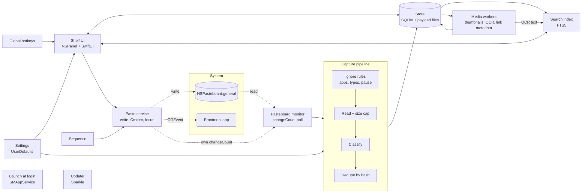

# Architecture

How Clipsy is built: subsystems, stack, data model, key flows, permissions, project layout and release pipeline. Product behavior and the keyboard map live in [product.md](product.md); visual design lives in [design.md](design.md). Platform, license, sync and distribution decisions live in [CLAUDE.md](../CLAUDE.md#decisions) and are not repeated here.

Terms: a **Card** is one captured clipboard entry. **History** is the time-ordered list of captured Cards. A **Board** is a named, colored collection of Cards kept outside retention. A **Sequence** is a queue of Cards pasted one after another. The **Shelf** is the panel that shows Cards.

Lines marked `> Decision needed:` wait on the maintainer. Lines marked `> TODO:` are unverified or open.

## 1. Overview



| Subsystem | Responsibility | Apple API |
|---|---|---|
| Pasteboard monitor | Detect clipboard changes; there is no change notification, so poll `changeCount` | `NSPasteboard.changeCount` ([doc](https://developer.apple.com/documentation/appkit/nspasteboard/changecount)) |
| Capture pipeline | Apply ignore rules, read all representations, enforce size cap, classify, dedupe | `NSPasteboard` ([doc](https://developer.apple.com/documentation/appkit/nspasteboard)), `NSWorkspace.frontmostApplication` |
| Store | Card metadata in SQLite, payloads as content-addressed files, retention | GRDB (see §2) |
| Search index | Full-text search over text, titles, URLs, file names, app names, OCR text | SQLite FTS5 |
| Thumbnails / preview | Card thumbnails; Space-bar Quick Look | `QLThumbnailGenerator` ([doc](https://developer.apple.com/documentation/quicklookthumbnailing/qlthumbnailgenerator)), ImageIO `CGImageSourceCreateThumbnailAtIndex` ([doc](https://developer.apple.com/documentation/imageio/cgimagesourcecreatethumbnailatindex(_:_:_:))), `NSPopover` + `QLPreviewView` ([doc](https://developer.apple.com/documentation/quicklookui/qlpreviewview)) per [design.md §5](design.md#quick-look) |
| OCR (optional) | Extract text from image Cards for search, on device | Vision `RecognizeTextRequest` ([doc](https://developer.apple.com/documentation/vision/recognizetextrequest)) |
| Link metadata (opt-in) | Page title and image for link Cards; one of the two opt-in network calls in [Decisions](../CLAUDE.md#decisions) | `LPMetadataProvider` ([doc](https://developer.apple.com/documentation/linkpresentation/lpmetadataprovider)) |
| Shelf UI | Non-activating panel over all Spaces and full-screen apps, SwiftUI content | `NSPanel` ([doc](https://developer.apple.com/documentation/appkit/nspanel)), `.nonactivatingPanel` ([doc](https://developer.apple.com/documentation/appkit/nswindow/stylemask-swift.struct/nonactivatingpanel)), `.fullScreenAuxiliary` ([doc](https://developer.apple.com/documentation/appkit/nswindow/collectionbehavior-swift.struct/fullscreenauxiliary)), `glassEffect` ([doc](https://developer.apple.com/documentation/swiftui/view/glasseffect(_:in:))), `GlassEffectContainer` ([doc](https://developer.apple.com/documentation/swiftui/glasseffectcontainer)), `NSGlassEffectView` ([doc](https://developer.apple.com/documentation/appkit/nsglasseffectview)) |
| Paste service | Write a Card to the pasteboard, synthesize Cmd+V into the target app | `AXIsProcessTrustedWithOptions` ([doc](https://developer.apple.com/documentation/applicationservices/1459186-axisprocesstrustedwithoptions)), `CGEvent` |
| Global hotkeys | Open Shelf, start Sequence, other user-bound shortcuts | Carbon `RegisterEventHotKey` (still the only public API) |
| Settings | Preferences in `UserDefaults`; SwiftUI `Settings` scene | — |
| Launch at login | Register the main app as a login item | `SMAppService.mainApp` ([doc](https://developer.apple.com/documentation/servicemanagement/smappservice)) |
| Updater | Signed appcast, in-place update; the other opt-in network call in [Decisions](../CLAUDE.md#decisions) | Sparkle 2 |

Process model: one agent app (`LSUIElement = YES`), not sandboxed, Hardened Runtime on (required for notarization). No helper processes, XPC services or login-item helper.

Concurrency (Swift 6 strict): the monitor and all UI are `@MainActor`. Reading pasteboard data happens on the main actor (AppKit requirement), then hashing, classification and DB writes move off the main actor. GRDB `DatabasePool` (WAL) gives concurrent reads and serialized writes, so no extra locking layer is needed.

## 2. Stack

| Area | Choice | Why | Alternatives considered |
|---|---|---|---|
| Language | Swift 6, strict concurrency | Current toolchain; data-race checks matter for a background capture pipeline | Swift 5 mode: no reason on a new codebase |
| Min OS | macOS 26 | Fixed in [Decisions](../CLAUDE.md#decisions); Liquid Glass without fallbacks | — |
| UI | AppKit `NSPanel` shell + `NSHostingView` with SwiftUI content; SwiftUI for Settings and onboarding | Pure SwiftUI `Window` cannot cleanly be non-activating and `fullScreenAuxiliary`; non-activating is what keeps the target app frontmost for paste | All-AppKit: more code, no benefit for card grids |
| Persistence | **GRDB.swift + SQLite FTS5**, payloads as files | Append-heavy history with tens of thousands of rows, prefix full-text search with diacritic folding, explicit versioned migrations, cheap bulk deletes for retention, observation for live UI | **SwiftData:** its main advantage was CloudKit sync, which we dropped. What remains is less code and `@Query`, against no FTS (search would be `LIKE`/in-memory fuzzy), weaker control over migrations and bulk deletes, unmeasured performance at 100k rows. **Core Data:** mature, but more boilerplate and still no FTS5 |
| Hotkeys | sindresorhus/KeyboardShortcuts | Carbon wrapper with a SwiftUI recorder and conflict handling; used by Maccy | soffes/HotKey (no recorder); own Carbon wrapper (~200 lines plus a recorder we would have to build) |
| Key codes for Cmd+V | Own code: `TISCopyCurrentASCIICapableKeyboardLayoutInputSource` + `UCKeyTranslate` | ~30 lines of Apple API; handles non-QWERTY layouts | Clipy/Sauce (MIT) does the same with more edge cases covered |
| Paste | Pasteboard write + `CGEvent` Cmd+V, recipe from Maccy/Clipy (MIT) | Proven across layouts; left-Cmd device flag fix from Flycut | Copy-only mode (always available as fallback) |
| OCR | Vision `RecognizeTextRequest`, `.accurate`, background | On-device, Swift-native API | `VNRecognizeTextRequest` (legacy API, same engine) |
| Updates | Sparkle 2 | Standard for Developer ID apps; EdDSA-signed appcast; simple when not sandboxed | Manual "new version" check against GitHub Releases API (still a network call, no in-place install) |
| Logging | `os.Logger` | System, no dependency; never interpolate clipboard content (§5) | swift-log: adds a dependency for nothing |
| Tests | Swift Testing (`import Testing`) | Ships with Swift 6 toolchain | XCTest for UI tests only |

Decided (2026-11-17): GRDB with FTS5 is the persistence layer. The maintainer approved it.

Decided (2026-11-17): KeyboardShortcuts handles global hotkeys and the recorder UI.

Sparkle is configured to match the network rule in [Decisions](../CLAUDE.md#decisions): automatic checks stay off until the user opts in.

## 3. Data model

Local-only. No sync fields, no UUIDs, no tombstones: integer row IDs are enough. SQLite holds metadata and the search index; pasteboard payloads live on disk.

### 3.1 Files

```text
~/Library/Application Support/Clipsy/      (0700)
  clipsy.sqlite (+ -wal, -shm)
  Payloads/<aa>/<sha256>                       content-addressed representation data
  Thumbnails/<sha256>.png                      image Cards and link preview images, keyed by card content hash
  Backups/Damaged Store <date time>/           a damaged store moved aside at launch (§3.4)
```

Working default [WD-18](roadmap.md#working-defaults-for-open-todos): `AppDatabase.defaultDirectory(bundleIdentifier:)` derives the directory from the app's bundle id. The released id `app.gonar.clipsy` keeps `~/Library/Application Support/Clipsy/`, so released data stays where it is; any other id, such as a dev build's, uses `~/Library/Application Support/<bundle id>/`, so it never shares the release's database.

### 3.2 Schema

```text
card
  id               INTEGER PRIMARY KEY
  kind             INTEGER NOT NULL      -- 1 text, 2 link, 3 image, 4 file, 5 color, 6 unknown
  content_hash     BLOB NOT NULL UNIQUE  -- sha256, see below
  title            TEXT                  -- user-set; NULL = derived from content
  preview_text     TEXT                  -- first ~1000 chars for the card face
  metadata         TEXT                  -- JSON, per kind: url, page title, pixel size,
                                         --   file count/total size, color value, char/word/line counts
  source_app_id    INTEGER REFERENCES source_app(id) ON DELETE SET NULL
  byte_size        INTEGER NOT NULL
  created_at       REAL NOT NULL         -- Unix seconds, like last_copied_at
  last_copied_at   REAL                  -- non-NULL = in History; drives order and retention
  board_id         INTEGER REFERENCES board(id) ON DELETE SET NULL
  board_position   REAL                  -- fractional index for drag reorder
  ocr_state        INTEGER NOT NULL DEFAULT 0   -- 0 n/a, 1 pending, 2 done, 3 failed
  CHECK (last_copied_at IS NOT NULL OR board_id IS NOT NULL)
  INDEX card_history ON card(last_copied_at DESC) WHERE last_copied_at IS NOT NULL
  INDEX card_board   ON card(board_id, board_position) WHERE board_id IS NOT NULL
  INDEX card_ocr_pending ON card(id) WHERE ocr_state = 1

representation                           -- one row per (pasteboard item, type), full fidelity
  card_id          INTEGER NOT NULL REFERENCES card(id) ON DELETE CASCADE
  item_index       INTEGER NOT NULL      -- index of the NSPasteboardItem
  type_index       INTEGER NOT NULL      -- original type order within the item
  uti              TEXT NOT NULL
  inline_data      BLOB                  -- small payloads (< 4 KB)
  payload_hash     TEXT                  -- file name in Payloads/
  byte_size        INTEGER NOT NULL
  PRIMARY KEY (card_id, item_index, type_index)
  CHECK ((inline_data IS NULL) <> (payload_hash IS NULL))
  INDEX representation_payload ON representation(payload_hash) WHERE payload_hash IS NOT NULL

board
  id INTEGER PRIMARY KEY, name TEXT NOT NULL, color TEXT NOT NULL  -- system color name
  position REAL NOT NULL, created_at REAL NOT NULL

source_app
  id INTEGER PRIMARY KEY, bundle_id TEXT NOT NULL UNIQUE, name TEXT NOT NULL
  -- icon resolved at runtime via NSWorkspace, not stored

card_search  FTS5(title, body, url, file_names, ocr_text, app_name,
                  tokenize = 'unicode61 remove_diacritics 2', prefix = '2 3')
  -- rowid = card.id; regular (not contentless) so snippet() works and deletes are plain
```

Rules:
- **content_hash:** SHA-256 over the sorted `(uti, data)` pairs after dropping volatile types (source markers, our own marker type, Office OLE link types). The same text copied from two apps dedupes; rich and plain versions of the same text do not.
- **History vs. Board:** a Card is in History when `last_copied_at` is set, on a Board when `board_id` is set, or both. A Card with neither is deleted. A Card is on at most one Board; adding it to another Board moves it.
- **Search index** is written by app code in the same transaction as the Card (the body comes from payloads, so SQL triggers cannot build it). OCR text updates the row later, and a link's page title replaces its body when the preview arrives ([WD-40](roadmap.md#working-defaults-for-open-todos)).
- **Settings** (retention, ignore lists, toggles, shortcuts) live in `UserDefaults`, not in the database.
- **Files** are stored by reference (`public.file-url` representation), not copied, per [product.md §4.1](product.md#41-capture); no bookmark is kept ([WD-4](roadmap.md#working-defaults-for-open-todos)).

- **Editing:** a save that produces a `content_hash` another Card already has is refused, and so is a new text Card with such a hash ([WD-7](roadmap.md#working-defaults-for-open-todos)).

### 3.3 Payload storage

- Representations of 4 KB or more go to `Payloads/`, named by SHA-256 of their bytes. Identical payloads across Cards share one file.
- Write order: write to a temp file, rename into place, then insert rows. A crash leaves an orphan file (collected later), never a row that points to a missing file.
- File Cards get Quick Look thumbnails (`Media.FileThumbnailer`), held in memory per file path, size and modification date and never written to `Thumbnails/`: the file can change on disk, and Quick Look keeps its own cache.
- Garbage collection runs after retention cleanup: delete files in `Payloads/` and `Thumbnails/` with no referencing row. Payload files are matched against `representation.payload_hash`, thumbnails against the hex `content_hash` of every Card.
- Decided (2026-11-17): garbage collection never races with capture. It runs on the database writer, which also runs the insert that stores a capture's payload files, so a file written before its row is inserted is never collected.
- Size cap: representations above the cap are dropped per type; if nothing is left, the capture is skipped. The cap is set in [product.md §4.1](product.md#41-capture).

> TODO: whether there is a total History size cap.

### 3.4 Migrations

- GRDB `DatabaseMigrator` with named, append-only migrations (`v1_initial`, `v2_…`). A migration is never edited after it ships in a release.
- Migrations run at launch before any UI shows. On failure the app shows an error and does not touch the database file.
- A store with an applied migration this build does not know was written by a newer Clipsy. GRDB's migrator would accept it silently, so `AppDatabase` checks `hasBeenSuperseded` first and throws without writing; the app says a newer version saved the history and quits.
- A damaged store is the exception: when opening or migrating fails with `SQLITE_CORRUPT` or `SQLITE_NOTADB`, the database files, `Payloads/` and `Thumbnails/` move to `Backups/Damaged Store <date time>/`, a new empty store is created, and an alert tells the user where the backup is, with a "Show in Finder" button.
- Each migration has a test that builds the previous schema with synthetic rows, migrates, and checks the result.
- `UserDefaults` key changes get a one-shot migration keyed by a stored settings version.

## 4. Key flows

### 4.1 Capture

1. `PasteboardMonitor` (main actor) sleeps on an injected clock (0.5 s, tolerance 0.1 s) and reads `NSPasteboard.general.changeCount`. Unchanged: return. A new count is handled on the next poll if it is still the same, so multi-step writes coalesce ([WD-1](roadmap.md#working-defaults-for-open-todos)). Reading the pasteboard happens on the main actor; hashing, metadata and the database write run off it.
2. Apply the skip rules in the order of [product.md §4.1](product.md#41-capture), rule 2: paused; own write (count equals the one recorded by our last write, or our marker type is present); no frontmost app (`NSWorkspace.shared.frontmostApplication`); ignored app; concealed types and password-manager sources when the concealed-content setting is on; `TransientType` / `AutoGeneratedType` when the temporary-content setting is on (see §5).
3. Read `pasteboardItems` → `types` → `data(forType:)`. Drop types over the size cap.
4. Classify in the order of [product.md §4.2](product.md#42-type-detection): file URL → file; image type → image; trimmed string that is a single URL → link; string that matches the hex or rgb rule → color; any text → text; otherwise unknown.
5. Compute `content_hash`. If a Card with that hash exists: set `last_copied_at = now` and its source app (this also brings a Board-only Card back into History) and stop.
6. Otherwise write payloads, then insert `card`, `representation` and `card_search` rows in one transaction.
7. Enqueue background work: an image Card is inserted with `ocr_state` pending, and `Media`'s `TextRecognitionQueue` recognizes pending Cards, newest first, while "Recognize text in images" is on ([WD-38](roadmap.md#working-defaults-for-open-todos)); link metadata if enabled. Image thumbnails are made by `Media` when the Card is first shown ([WD-32](roadmap.md#working-defaults-for-open-todos)).
8. Store the handled `changeCount` in `UserDefaults` (also for skipped changes, so resuming does not capture what was copied while paused) so a relaunch does not recapture the current clipboard. Each new card id is emitted on `capturedCardIDs` for the menu bar effect and the Sequence.

Working default [WD-2](roadmap.md#working-defaults-for-open-todos): `com.apple.is-remote-clipboard` and `org.nspasteboard.source` are ignored; the source is always the frontmost app and remote copies are captured like local ones.
Working default [WD-1](roadmap.md#working-defaults-for-open-todos): no separate debounce; a change is processed one poll tick (0.5 s) after it is first seen, so multi-step writes coalesce.

### 4.2 Paste

1. When the Shelf opens, record the frontmost app as the paste target. The Shelf is non-activating, so the target stays frontmost.
2. On paste: `clearContents()`, write every stored representation in original item and type order, and add our marker type. For "paste as plain text", write only `public.utf8-plain-text`; a Card without it is written in full (WD-25 in [roadmap.md](roadmap.md)). Record the resulting `changeCount` so capture ignores it. A paste does not update `last_copied_at` ([WD-6](roadmap.md#working-defaults-for-open-todos)).
3. Hide the Shelf.
4. If the target app is no longer frontmost, activate it and wait for activation.
5. If `AXIsProcessTrusted()`: post Cmd+V via `CGEvent`: source `.combinedSessionState`, local events suppressed during the post, key code for "V" from the current ASCII-capable layout (`UCKeyTranslate` with ⌘ held, so layouts such as Dvorak – QWERTY ⌘ get their ⌘ key; `kVK_ANSI_V` if no key types "v"), Cmd flag plus the left-Cmd device bit, posted to `.cgSessionEventTap`.
6. Without Accessibility: the Card stays on the pasteboard (copy-only); the first time, explain how to enable direct paste.

Multiple selected Cards (`PasteCoordinator`, `CombinedPayload`): text only (text, link and color Cards) → one plain string joined with `\n`; files → one write with every file URL, one item per URL; mixed kinds → one write with each Card's items in turn. Cards go oldest first by `last_copied_at`, falling back to `created_at` for a Board Card that has left History ([product.md §4.12](product.md#412-multi-select)).

Working default [WD-21](roadmap.md#working-defaults-for-open-todos): the previous clipboard is not restored after a paste, and pastes do not use `prepareForNewContents(with: .currentHostOnly)` ([doc](https://developer.apple.com/documentation/appkit/nspasteboard/preparefornewcontents(with:))).

### 4.3 Quick paste

While the Shelf is key, Cmd+1…9 runs the paste flow on the Nth Card counted from the first visible Card. Number badges appear while the modifier is held. This is local key handling in the panel; no global hook.

### 4.4 Sequence

1. The Sequence hotkey opens the Sequence window. If triggered from another app, synthesize Cmd+C there; the next captures are appended to the Sequence (front or back per the direction setting) while the window is open.
2. The head Card is placed on the pasteboard ahead of time. The user pastes with their normal Cmd+V; we do not intercept it.
3. When the paste is detected, the head is removed and the next Card is placed on the pasteboard. After the last Card, the window closes.
4. "Paste all": text Cards joined with `\n`, one paste.
5. Sequence state (ordered Card IDs, direction, undo stack) lives in memory in `Pasting.PasteSequence`; the plain-text flag is kept in `UserDefaults` so it persists across Sequences. Cards stay in History. Details: WD-26 in [roadmap.md](roadmap.md).

Paste detection lives in `Pasting.SequencePasteDetector`. `Pasting.SequenceCoordinator` publishes the head entry with its representations and the plain-text flag, calls `PasteSequence.didPaste` for each entry ID the detector reports, and then publishes the new head. Two mechanisms exist; the app uses (a).
- (a) Lazy data provider (default, no permission). `PasteboardWriter.writeLazily` promises every type through `NSPasteboardItemDataProvider`; only our marker type is written eagerly, so Capture skips the write without reading data. The first data request for the published head counts as its paste. Requests for its other types, and requests after `stop()`, report nothing. Edit > Paste from the menu counts as well as ⌘V.
- (b) Fallback: global key-down monitor (`PasteKeyMonitor`, needs Accessibility). The head is written eagerly; a key-down of the layout's ⌘V key (`KeyCodeResolver`) with ⌘ and without ⌃ counts as the paste (⇧ and ⌥ still paste, as in Paste and Match Style). It cannot see Edit > Paste clicks, and ⌘V in an app that ignores it still advances.

After a paste is detected, the detector waits 250 ms before reporting it, so the target can read all its types before the next head replaces the pasteboard. A second ⌘V within that window pastes the same Card again.

Findings:
- The provider callback fires once per type: after it supplies the data, the pasteboard keeps it, so a repeated read does not call back.
- Checking `types`, `availableType(from:)` or `canReadItem(withDataConformingToTypes:)`, as apps do for menu validation, does not call the provider. A read in the same process calls it synchronously. Both are covered by `SequencePasteDetectorTests`.
- Anything that reads the data of every pasteboard change advances the Sequence early: another clipboard manager, or an app that reads data, not just types, when it gains focus. Use (b) if the human check finds such a case among common apps.

> TODO: whether Universal Clipboard (Handoff) reads promised data eagerly; if it advances the Sequence early, write Sequence heads with `prepareForNewContents(with: .currentHostOnly)`.

### 4.5 Retention cleanup

Runs at launch, hourly, and when the retention setting is lowered (after confirmation in the UI).

1. `cutoff = now − retention`.
2. Board Cards leave History: `UPDATE card SET last_copied_at = NULL WHERE board_id IS NOT NULL AND last_copied_at < cutoff`.
3. Delete expired History Cards: `DELETE FROM card WHERE board_id IS NULL AND last_copied_at < cutoff`, with matching `card_search` rows, in one transaction. `representation` rows cascade.
4. Garbage-collect payload and thumbnail files (§3.3).

"Erase History" is the same with `cutoff = +∞`. Deleting a Board first deletes its Cards that are not in History, then clears `board_id` on the rest, then deletes the board row, in one transaction.

## 5. Permissions and privacy

| Topic | Design |
|---|---|
| Accessibility | Needed only for direct paste (synthesized Cmd+V) and for Cmd+C when starting a Sequence. Request via `AXIsProcessTrustedWithOptions` with the prompt option on first direct paste, not at launch. Re-check on app activation. The grant is tied to the code signature: dev builds must be signed with a stable certificate or TCC asks again on every build. |
| Pasteboard access (macOS 15.4+) | `NSPasteboard.accessBehavior` ([doc](https://developer.apple.com/documentation/appkit/nspasteboard/accessbehavior-swift.enum)) is `.default`, `.ask`, `.alwaysAllow` or `.alwaysDeny`. A clipboard manager reads programmatically in the background, so it needs `.alwaysAllow`. Check at launch and on wake; on `.ask` or `.alwaysDeny`, show a one-time alert with an "Open System Settings…" button ([design.md §9](design.md#9-onboarding-and-permissions), [WD-37](roadmap.md#working-defaults-for-open-todos)); the button opens the `Privacy_Pasteboard` pane ([product.md §4.1](product.md#41-capture)). Use `detectedPatterns(for:)` for alert-free sniffing where it is enough. |
| Screen sharing | The Shelf and Sequence windows set `sharingType = .none` by default, with a setting to show them. |
| Concealed and transient content | Skipped per the Privacy toggles in [product.md §4.1](product.md#41-capture) (both on by default): nspasteboard.org `ConcealedType` and 1Password legacy types under the concealed-content setting; `TransientType` and `AutoGeneratedType` under the temporary-content setting. Ignored-apps default and the list of password managers treated as concealed sources (Keychain Access among them) are defined there too. |
| Logging | Clipboard content, previews, OCR text, URLs and file names are never logged, printed, put in crash reports or test fixtures. Logs carry only events, counts, sizes and UTIs. No third-party crash reporting. |
| Network | Only the two opt-in calls in [Decisions](../CLAUDE.md#decisions): link metadata and Sparkle update checks (§2). |
| Spotlight / Shortcuts | History is not exported to Spotlight. |
| Data at rest | Database and payload files in a 0700 directory, protected by FileVault; no app-level encryption. |

> TODO: is pasteboard privacy enforced by default on macOS 26/27, and does reading `changeCount` or `types` (not contents) trigger the alert? Only third-party reports exist (see the [mjtsai summary](https://mjtsai.com/blog/2025/05/12/pasteboard-privacy-preview-in-macos-15-4)). Test on a clean user account.
> TODO: verify that ScreenCaptureKit-based recorders honor `sharingType = .none` on macOS 26.
> TODO: which TCC bucket `CGRequestPostEventAccess()` ([doc](https://developer.apple.com/documentation/coregraphics/cgrequestposteventaccess())) maps to; if it is narrower than Accessibility it could replace it for paste.

## 6. Project layout, testing, CI, releases

### 6.1 Layout

A thin Xcode app target plus one local Swift package with feature modules. Xcode owns signing, entitlements, Info.plist, assets and the archive; the package owns code and is testable with `swift test`.

```text
Clipsy.xcodeproj
App/                        app target: entry point, AppDelegate, menu bar item, Settings scene,
                            onboarding, hotkeys, launch at login, Sparkle wiring, App Intents declarations
Packages/ClipsyKit/
  Package.swift
  Sources/
    Store/                  GRDB schema, migrations, records, retention, payload files, search queries
    Capture/                monitor, ignore rules, reader, classifier, hashing
    Media/                  thumbnails, OCR, link metadata
    Pasting/                paste service, key codes, Sequence state machine
    DesignSystem/           design tokens (spacing, radii, sizes from design.md), shared SwiftUI components
    ShelfUI/                NSPanel, SwiftUI Shelf, Cards, search field, Quick Look
    Updates/                Sparkle wrapper: the updater starts only after opt-in or a manual check
    Integrations/           store calls behind App Intents
  Tests/                    one test target per module, plus SnapshotTests (design.md §2, Snapshot harness)
scripts/release/            release scripts: archive, notarize, DMG and zip, appcast (§6.4)
```

This is the module list; other docs link here instead of repeating it.

Dependency direction: `ShelfUI` → `DesignSystem`, `Pasting`, `Media`, `Store`, KeyboardShortcuts; `Pasting` → `Store`; `Capture` → `Store`; `Media` → `Store`; `Updates` → Sparkle; `Integrations` → `Capture`, `DesignSystem`, `Store`; the app target's Settings and onboarding use `DesignSystem`; `Store` and `DesignSystem` depend on nothing in the package.

Decided (2026-11-17): a plain, committed `Clipsy.xcodeproj`. `App/` is a folder-synchronized group, so new files there need no project edits. The app links one umbrella product, `ClipsyKit`, so adding a module only changes `Package.swift`. Never hand-edit `project.pbxproj` unless a build setting has to change.

Identity per configuration (T14.8): Release is the shipped app, Debug is "Clipsy Dev", so a dev build never shares the release's UserDefaults, URL scheme, TCC grants, LaunchServices entry or database (§3.1). The app target's build settings set:

| Setting | Release | Debug |
|---|---|---|
| `PRODUCT_BUNDLE_IDENTIFIER` | `app.gonar.clipsy` | `app.gonar.clipsy.dev` |
| `INFOPLIST_KEY_CFBundleDisplayName` | `Clipsy` | `Clipsy Dev` |
| `CLIPSY_URL_SCHEME` | `clipsy` | `clipsy-dev` |

`PRODUCT_NAME` stays `Clipsy` in both, so the product is `Clipsy.app`. `Config/Info.plist` declares the URL type from `$(CLIPSY_URL_SCHEME)` with `CFBundleURLName = $(PRODUCT_BUNDLE_IDENTIFIER)`. The app reads the scheme from `Bundle.main` and passes it to `URLRoute`, so the [grammar](product.md#37-integrations) is the same under either scheme. The menu bar item's accessibility label and tooltip are the bundle's display name.

Global shortcut defaults (T14.11) follow the bundle id, so a dev build never takes the release's hotkeys: `app.gonar.clipsy` uses the [keyboard map](product.md#5-keyboard-map) defaults, any other id uses ⌃⇧⌘V (Shelf) and ⌃⇧⌘C (Start Sequence) and leaves Paste All unset. Neither dev combination is a macOS symbolic hotkey (checked with `CopySymbolicHotKeys` on macOS 27.2). A default is written only while UserDefaults holds no value for the name, so a dev build that already stored the release defaults keeps them until Restore Defaults.

### 6.2 Testing

- **Unit (Swift Testing):** classifier, hashing and dedupe rules, ignore rules, size cap, retention SQL, Board deletion, FTS queries (prefix, diacritics), Sequence state machine, migrations.
- **Pasteboard tests** use private named pasteboards (`NSPasteboard(name:)`), never `.general`.
- **Fixtures are synthetic.** Never build test data from real clipboard content.
- **Performance:** seed 100k synthetic Cards, measure search latency and launch time. `PerformanceTests` in `StoreTests` does this only when `CLIPSY_PERF=1`, so `scripts/build.sh test` skips it. Run `scripts/perf.sh` before every release and when a change touches the schema or search, and compare its timings with the baseline below.
- **Manual checklist per release:** direct paste into a native app, a browser, a terminal and an Electron app; non-QWERTY layout; full-screen Space; second display; Accessibility revoked; screen recording hides the Shelf.

Baseline (2026-11-17, Apple M5 Pro, macOS 27.2, debug build, run alone): 100k text and link Cards with 13 words each in History. Search times are the median of five runs.

| Measurement | Time | Results |
|---|---|---|
| Seed (one transaction) | 1.8 s | |
| Open the database and run migrations | 3 ms | |
| History load (`cards(in: .history)`, what the Shelf observes) | 250 ms | 100,000 |
| Search, 2-character prefix | 1.44 s | 68,885 |
| Search, one common word | 62 ms | 3,006 |
| Search, two words | 2 ms | 74 |
| Search, unique token | 0.1 ms | 1 |
| Kind filter, no text | 121 ms | 10,000 |
| One word plus kind filter | 8 ms | 279 |

Search and history load return every match, so their time grows with the result count; a short prefix over a large history is the slow case.

> TODO: set the performance budget (search latency, launch time) from this baseline; the test asserts only result counts until then.

### 6.3 CI (GitHub Actions)

- Per pull request: lint only, on Linux (`.github/workflows/lint.yml`); it is the required check. It runs the dynamic `swiftlint` with SourceKit from the runner's preinstalled Swift toolchain, because the static binary skips `custom_rules` such as `no_print`. A smoke test fails the job when SwiftLint skips a rule or passes a file with `print(`.
- By hand (`workflow_dispatch`): two parallel macOS jobs, ad-hoc signed, no secrets. `app` runs `scripts/build.sh`; `test` runs `swift package resolve` (up to 3 attempts, so a transient clone failure does not fail the run) and then `swift test --disable-xctest` without `--quiet`, so test timings show in the log. macOS runners are slow to start, so builds and tests normally run locally.
- Each job caches its own SPM checkouts: `app` the xcodebuild `SourcePackages`, `test` the package's `.build/checkouts` and `.build/repositories`.
- Runner: `xcode-27` (macOS 27, arm64, a preview image) with Xcode 27.2 selected through `DEVELOPER_DIR`, as listed in [actions/runner-images](https://github.com/actions/runner-images). The `macos-26` image tops out at Xcode 26.6, whose Swift 6.3.3 crashes compiling the app. The release workflow uses the same runner. The workflow is `.github/workflows/build.yml`.

> TODO: move `build.yml` and `release.yml` to the GA macOS 27 label once actions/runner-images publishes one; a preview label can be renamed or removed.

Formatting and linting use SwiftFormat and SwiftLint, the pair most popular macOS apps use. The rules are in [.claude/rules/code-rules.md](../.claude/rules/code-rules.md).

### 6.4 Release pipeline

Triggered by a maintainer pushing tag `vX.Y.Z` on `main` (see [CONTRIBUTING.md](../CONTRIBUTING.md#releases)).

1. Import the Developer ID Application certificate from repository secrets into a temporary keychain.
2. Set `CFBundleShortVersionString` from the tag; build number from the run number.
3. `xcodebuild archive`, then `-exportArchive` with the Developer ID method and Hardened Runtime.
4. Notarize with `xcrun notarytool submit --wait` using an App Store Connect API key from secrets; `xcrun stapler staple` the app.
5. Package: `ditto -c -k --keepParent` for the zip (Sparkle feed) and `hdiutil` for the DMG; sign, notarize and staple the DMG.
6. Sparkle's `generate_appcast` signs the zip with the EdDSA private key from secrets and adds it to the appcast of the latest release, keeping the newest 3 versions.
7. `gh release create vX.Y.Z --generate-notes` (grouped by [.github/release.yml](../.github/release.yml)), attach DMG, zip and `appcast.xml`.
8. The appcast is published by step 7: the feed URL points at the latest release's `appcast.xml`.

Secrets never enter the repository; only GitHub Actions secrets or the maintainer's shell environment.

Workflow (T13.3): [.github/workflows/release.yml](../.github/workflows/release.yml) runs steps 1–7 on tags matching `vX.Y.Z`. It derives `DEVELOPER_ID_APPLICATION` and `APPLE_TEAM_ID` from the imported certificate, writes the API key to a temporary `.p8` for `NOTARY_KEY_PATH`, and removes the keychain and key file at the end even when a step fails. The secrets are listed in [CONTRIBUTING.md](../CONTRIBUTING.md#release-secrets).

Decided (2026-11-17): the appcast is a GitHub Release asset at `https://github.com/alekseylopukh/clipsy/releases/latest/download/appcast.xml` (the `SPARKLE_FEED_URL` build setting). Each item downloads its zip from `releases/download/vX.Y.Z/`, so older items stay valid. The signing identity, notarization key and Sparkle keys come from environment variables; the public key stays a placeholder build setting and a release overrides it.

Scripts (T13.2) in `scripts/release/` run steps 2–6; they write to `.build/release/` and stop with a list of the missing variables before doing any work. `release.sh [--dry-run] <version> <build-number>` runs them in order: `archive.sh` (steps 2–3), `notarize.sh` for the app and then the DMG (step 4), `package.sh` (step 5), `appcast.sh` (step 6). `--dry-run` keeps the ad-hoc signature, skips notarization, signs the appcast with a throwaway Sparkle key and needs no secrets.

| Variable | Used by | Value |
|---|---|---|
| `DEVELOPER_ID_APPLICATION` | archive, package | Developer ID Application identity in the keychain, e.g. `Developer ID Application: Name (TEAMID)` |
| `APPLE_TEAM_ID` | archive | Team ID of that certificate |
| `NOTARY_KEY_PATH`, `NOTARY_KEY_ID`, `NOTARY_ISSUER_ID` | notarize | App Store Connect API key file (`.p8`), its key ID and issuer ID |
| `SPARKLE_PUBLIC_ED_KEY` | archive | Sparkle EdDSA public key, overrides the placeholder build setting |
| `SPARKLE_PRIVATE_ED_KEY` | appcast | Sparkle EdDSA private key (`generate_keys -x`), passed on standard input |

Signing configuration (T13.1): `Config/Info.plist` is merged into the generated Info.plist and sets `SUFeedURL` and `SUPublicEDKey` from the build settings `SPARKLE_FEED_URL` and `SPARKLE_PUBLIC_ED_KEY`, and `SUEnableAutomaticChecks = NO`. `SPARKLE_PUBLIC_ED_KEY` stays a placeholder in the project; a release sets it from the environment. The app has Hardened Runtime, no sandbox and no entitlements: Sparkle needs none outside the sandbox, and paste uses `CGEvent` (Accessibility), not Apple Events. Release builds do not inject `get-task-allow`. Hardened Runtime's library validation refuses an ad-hoc-signed `Sparkle.framework`, so a Release build only launches once it is signed with a Developer ID; local runs use Debug: Xcode signs it ad hoc without Hardened Runtime, and `scripts/build.sh` then re-signs it with Hardened Runtime and the local Apple Development identity when one exists, so Sparkle passes library validation and Accessibility survives rebuilds.

A Homebrew cask is not part of v1; it is listed under Later in [roadmap.md](roadmap.md#later-not-scheduled).

## 7. Dependencies and references

### 7.1 Third-party dependencies

They follow the dependency rule in [CLAUDE.md Decisions](../CLAUDE.md#decisions).

| Package | Use | License | GPL-3.0 compatible |
|---|---|---|---|
| [groue/GRDB.swift](https://github.com/groue/GRDB.swift) | SQLite, FTS5, migrations | MIT | Yes |
| [sindresorhus/KeyboardShortcuts](https://github.com/sindresorhus/KeyboardShortcuts) | Global hotkeys, recorder | MIT | Yes |
| [sparkle-project/Sparkle](https://github.com/sparkle-project/Sparkle) | Updates | MIT; bundled code under BSD-2-Clause, MIT and zlib | Yes |

Optional, only if our own code proves insufficient: [Clipy/Sauce](https://github.com/Clipy/Sauce) (MIT, layout-aware key codes).

Notices of every dependency and of any copied code go into an Acknowledgements screen in About and into the source file headers of copied code.

Decided (T13.1): Sparkle 2.10.1's `LICENSE` is MIT, and the code it bundles is bsdiff (BSD-2-Clause), sais-lite (MIT), ed25519 (zlib) and SUSignatureVerifier (BSD-2-Clause). All are GPL-3.0-compatible; the notices are in [THIRD_PARTY_NOTICES.md](../THIRD_PARTY_NOTICES.md) and `App/Credits.rtf`.

### 7.2 Projects to learn from

| Project | License | Worth reading | Code reuse |
|---|---|---|---|
| [p0deje/Maccy](https://github.com/p0deje/Maccy) | MIT | Polling, CGEvent paste, floating panel, one-row-per-type storage, sequential paste queue | Yes, with notice |
| [Clipy/Clipy](https://github.com/Clipy/Clipy) | MIT | Paste service | Yes, with notice |
| [TermiT/Flycut](https://github.com/TermiT/Flycut) | MIT | Left-Cmd flag fix ([PR #18](https://github.com/TermiT/Flycut/pull/18)) | Yes, with notice |
| [momenbasel/pesty](https://github.com/momenbasel/pesty) | MIT | Bottom-shelf UX, Boards | Yes, with notice |
| [sindresorhus/Pasteboard-Viewer](https://github.com/sindresorhus/Pasteboard-Viewer) | MIT | Dev tool to inspect real pasteboard types | Tool only |
| [mobrava/Clipbara](https://github.com/mobrava/Clipbara) | GPL-3.0 | Card UI, Quick Look, direct-paste build | Yes, with notice |
| [lifedever/PasteMemo-app](https://github.com/lifedever/PasteMemo-app), [SwallOwDili/OpenPaste](https://github.com/SwallOwDili/OpenPaste) | GPL-3.0 | Ideas | Yes, with notice |
| [openpaste/openpaste](https://github.com/openpaste/openpaste) | AGPL-3.0 | — | **No** |
| [yuzeguitarist/Deck](https://github.com/yuzeguitarist/Deck) | AGPL-3.0 + All Rights Reserved | — | **No** |
| [vladimir-ikryanov/ClipBook](https://github.com/vladimir-ikryanov/ClipBook) | Custom restricted | — | **No** |
| [appdev/ClipDock](https://github.com/appdev/ClipDock) | None | — | **No** |

Before copying code from a GPL-3.0 project, check whether it is "only" or "or later" and match our license header accordingly.

## 8. Open questions

These need a test on real hardware or a maintainer decision. The rest of this document is settled or follows a working default in [roadmap.md](roadmap.md#working-defaults-for-open-todos).

> TODO: pasteboard-privacy enforcement on macOS 26/27 and whether polling `changeCount` or reading `types` triggers the alert (§5). Test on a clean user account.
> TODO: Quick Look popover (`NSPopover` + `QLPreviewView`) inside a non-activating panel: prototyped in T8.1 ([design.md §5](design.md#quick-look)); the live behavior is still a human check of T8.1.
> TODO: Universal Clipboard: whether Handoff reads promised Sequence data eagerly (§4.4); remote copies are captured and our pastes are not kept local until then ([WD-2](roadmap.md#working-defaults-for-open-todos), [WD-21](roadmap.md#working-defaults-for-open-todos)).
> TODO: total History size cap (§3.3).
> TODO: verify that ScreenCaptureKit-based recorders honor `sharingType = .none` on macOS 26 (§5).
> TODO: which TCC bucket `CGRequestPostEventAccess()` maps to, and whether it could replace Accessibility for paste (§5).
> TODO: performance budget for search latency and launch time, set from the §6.2 baseline.
